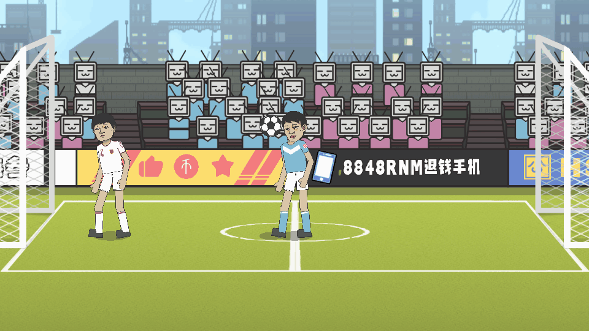
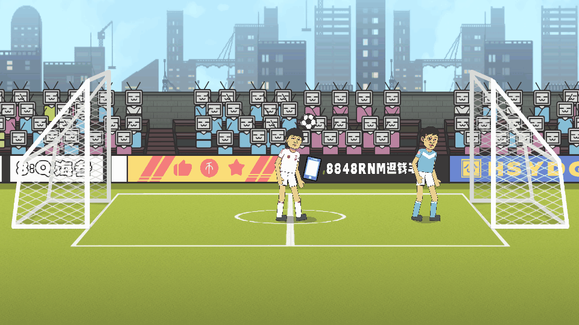

# 倒钩高位持腿

## 2026-10-16 倒钩高位持腿

按用户参考图调整双方倒钩：保留正常迎球和真实脚端碰撞，触球后踢球腿维持较高且舒展的随摆，延长空中高位姿态；另一条腿流畅抬至水平以上，避免向下耷拉。保持原有双髋目标夹角上限100度，不扩大成劈叉。

取消旧的按固定时间提前收腿，改为真实背部接地后才衔接收腿起身。保留内侧手持续抬起、整体镜像与站稳后恢复朝向、正常比赛镜头和速度、倒钩30%/30%/40%质量，以及身后/后背触球和进球后禁止新动作的限制。没有给范志毅特技模式添加磁力脚。

两版各4个真实动作场景、36项精简检查通过：双方两个球高的脚端真实触球和正确出球方向，持续高位踢球腿、成型后另一脚不低于髋部水平、内侧手保持抬起、关节连续、背部先着地和起身恢复。实际踢球脚高位保持约0.58—0.72秒。录帧验证固定100帧模拟步长以隔离保存图片的耗时影响，正式游戏不设置录帧步长或慢动作。

本轮仅调整动作，不自战。测试副本退出即删除，保留可复跑测试和验证记录；F vs Z与完整下载包由用户通过GitHub Desktop自行提交推送。局部预览只是实际全场录像的裁剪，不改变比赛镜头。

