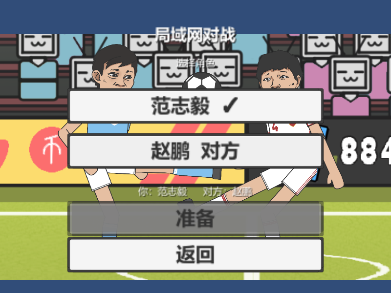
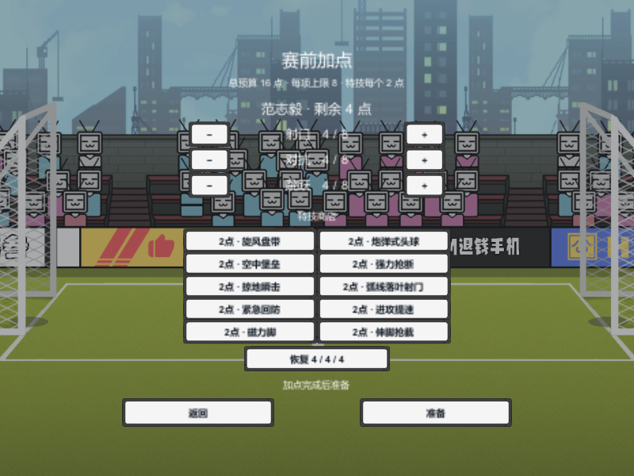

# 联机选角、两阶段准备与输入调度更新

日期：2026-10-12。适用：Windows 32 位原版和模型 75% 实验版。

## 流程

- 经典／特技：创建或加入房间 → 各自选择不同角色 → 双方准备 → 比赛。
- 加点：创建或加入房间 → 各自选择不同角色 → 双方第一次准备 → 各自配置自己的角色 → 双方第二次准备 → 比赛。
- 房主可以选择赵鹏，加入者可以选择范志毅。输入及比赛角标跟随选择结果，使用所选角色在该电脑上的原有按键配置。
- 选角页使用透明全屏布局、主菜单背景及现有按钮和字体。加点页复用现有加点界面，只显示该玩家拥有的角色。
- 选角阶段可取消准备。加点后的等待页显示双方角色及准备状态；离开房间会清理配置页面与会话状态。

## 网络修改

房主统一确认选角、准备状态和最终加点。加入者的命令带序号、会话及阶段编号，在确认前重发；重复命令不会重复切换准备状态。房间状态与开赛命令也会重发，开赛要求相符的最新房间状态。旧阶段的准备消息不能替代加点完成后的准备。

双方加点均先检查等级、技能掩码与预算，再写入正式配置。房主心跳不能覆盖加入者正在编辑的配置。负数技能掩码会直接拒绝，避免计数死循环。

`LanInputPump` 在角色的常规更新之前收包并发送输入，物理步开始前也补收输入。`LanMultiplayer` 保留原来的晚序物理快照发送和客机显示前快照应用，保留物理步长、求解精度、动作确认、二进制输入与快照格式及发送频率。收包时关闭连接不会继续访问已关闭的 socket。

此次改动消除了原先网络收包位于角色输入消费之后的执行顺序，可能减少一帧的程序内部等待；这是执行顺序分析，并非实体局域网延迟测量。没有降低画质、削减特效或调整技能与 AI 参数。

## 验证与安装

两版分别运行游戏内界面检查、现有加点／正常玩法检查，以及两个独立 Unity 进程的 UDP 回环联机。检查覆盖选角互斥、单方准备不启动、取消准备、房主选择赵鹏、三种模式、两阶段准备、独立加点、过期消息、输入确认、远端控制映射、比分快照、断线和重新进房。

| 最终检查 | 32 位原版 | 模型 75% 实验版 |
| --- | --- | --- |
| 游戏内界面 | 36 项通过，0 失败 | 36 项通过，0 失败 |
| 加点与正常玩法 | 34 项通过，0 失败 | 34 项通过，0 失败 |
| 双进程 UDP：房主 | 71 项通过，0 失败 | 71 项通过，0 失败 |
| 双进程 UDP：加入者 | 67 项通过，0 失败 | 67 项通过，0 失败 |
| 正式游戏包逐文件校验 | 149 个文件一致 | 151 个文件一致 |

最终日志无异常。初次检查中的选角状态与比分采样时序问题、错误使用角色根节点 Rigidbody 作为测试组件的问题已修正，并复跑通过。正式构建在编译后使用 Cecil 检查，未包含自动测试类型或调用。源码哈希与通过检查的版本一致；已安装到两个正式目录，完整 ZIP 也已重建。个人按键配置 SHA-256 与修改前一致。

原始日志、截图和本次源码哈希保存在 `.work/adaptation`；可用 `tools/performance/RunAdaptation.ps1` 重跑。每个测试结束后删除隔离游戏副本。正式安装使用 `InstallRelease.ps1 -AdaptLatest`，核对测试源码哈希，重新编译并确认正式 DLL 没有测试组件，备份安装前 DLL，并逐文件核对完整游戏 ZIP。

原版与实验版的按键配置需在安装后分别与安装前 SHA-256 对照。备份位置：`.work/adaptation/lan-before`（此次修改前的源码及运行 DLL），以及正式目录 `AI Mod Source/backup-before-performance-*`。

两台实体电脑之间的实际延迟、无线网络丢包表现及多网卡地址选择尚未在此次本机回环检查中测量。双方应安装同一新版；第 2 版房间协议不兼容旧版自动开赛流程。
