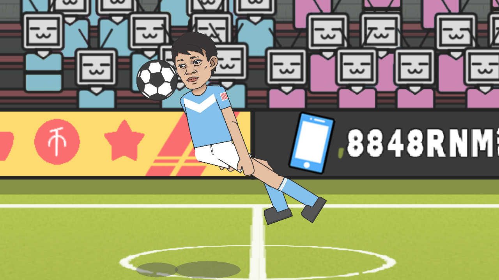
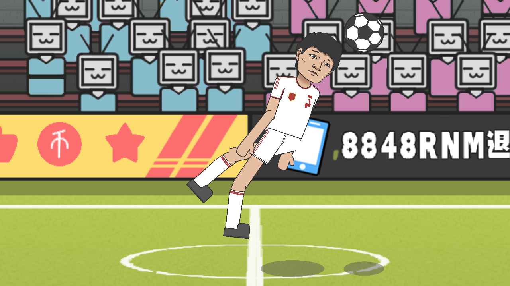

# 技能调整与无定形射门

## 2026-10-15 技能调整与无定形射门（覆盖旧规则）

紧急回防以正常回防的200%为速度上限，按实际移动同步回防步频。旋风盘带向前带球速度提升40%。磁力脚配合射门迎接身前高球，以真实脚部迎球和适量物理起跳改善触球，射门质量等效射门+1，上限8；保留各版模型差异。

头球命令每次实际触球只发动一次，头顶和脸部真实接触可以触发已购炮弹头球，踢球命令也可准备头顶/脸部头球；后脑勺接触不能被吸到前面再发射。普通赵鹏大力射门取消贴地球路辅助。移除赵鹏掠地瞬击特技，商店同槽替换为后防领袖：打平或领先时等效对抗、跳跃各+1.5，落后立即取消，实际点数保持不变。空中堡垒在近身争高空球时额外等效对抗、跳跃各+1。强力抢断击退基准改为一个身位，保留实际接触、点数衰减和高对抗免疫失衡。

范志毅特技模式增加无定形射门，双方加点商店都可购买（2点）。大腿、脚底等下半身未吃正部位，以及身体失衡、空中不直立、地面劈叉、被强力抢断撞开后的实际触球，补救射门保留正常球速和精度的90%；正常吃正的射门继续使用原技能。所有发射必须真实下半身触球。

倒挂金钩由跳跃＋射门组合触发（允许0.35秒内接续），球在身后一个身位内；最低高度为指令时实际躯干上半身，最高为当时头顶再加一个头的高度。符合时有50%概率发动：完整镜像球员及连接骨架，先背对进攻方向，再起跳转体，真实脚部触球后发射；镜像持续到落地并起身站稳，才恢复。两人流程一致。聚焦球员居中放大，以0.5倍慢动作播放，脚即将触球时恢复全场镜头和速度。低/中/高质量分别70%/20%/10%：高慢球、快而贴地、快且瞄准死角。局域网同步镜头和镜像状态。

只对无定形射门追加每版200次真实入球双AI自战，逐球记录成功/失败，未移动球员、足球或改写计分。其他改动用35项精简专项检查，另核对新技能槽与联机同步。测试退出即删除隔离副本。F vs Z与完整下载包更新，由用户在GitHub Desktop提交推送。

|版本|专项|真实进球|范 / 赵|无定形射门|倒挂触发 / 尝试|真实倒挂射门（范 / 赵）|
|---|---:|---:|---|---:|---|---:|
|原版|35 / 35|200|76 / 124|364|65 / 161|6 / 2|
|模型75%实验版|35 / 35|200|99 / 101|418|86 / 176|5 / 4|

双方联机端各85项检查通过。逐球记录、最终日志与生产源码哈希见 [validation/skill-rework-20261015](validation/skill-rework-20261015)。

